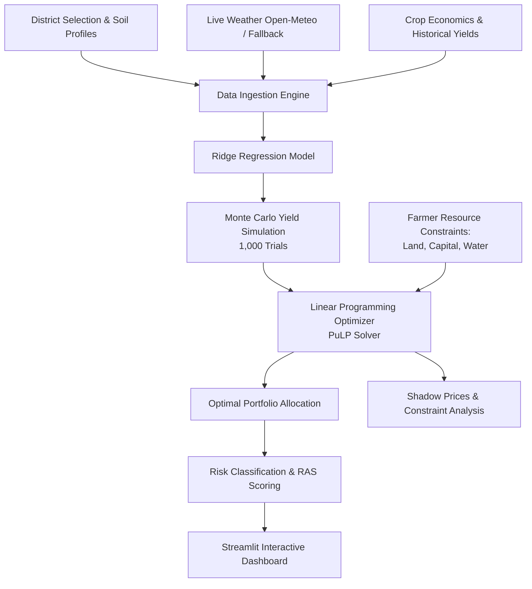

# CropOpt: Multi-Source Crop Portfolio Optimization Engine

[](https://www.python.org/)
[](https://streamlit.io/)
[](https://coin-or.github.io/pulp/)
[](LICENSE)

**CropOpt** is an intelligent decision support pipeline designed to help smallholder farmers and agricultural planners optimize crop allocation under real-world constraints. Instead of simplistic single-crop recommendations, CropOpt balances expected profit and stochastic risk across multiple crops under land, capital budget, and water availability constraints.

---

## 🌟 Key Features

- **Multi-Source Data Ingestion & Live Weather**:
  - Integrates 20+ years of historical Area-Production-Yield (APY) records, district soil profiles (pH, organic carbon, NPK, texture), and crop economics (production costs, MSP/market prices).
  - Integrates live meteorological data via the Open-Meteo API with automatic historical fallbacks.

- **Yield Prediction via Regularized Ridge Regression**:
  - Predicts crop-specific yields from climate and soil factors.
  - L2 penalty mitigates multi-collinearity across weather and soil parameters, avoiding overfitting on historical data.

- **Stochastic Risk Quantification (Monte Carlo Simulation)**:
  - 1,000-trial Monte Carlo simulation sampling weather variability and yield distributions.
  - Quantifies 10th-percentile (downside risk), mean, and 90th-percentile yield boundaries.

- **Multi-Constraint Linear Programming (LP)**:
  - Formulated with **PuLP** to maximize total expected net farm profit.
  - Hard constraints for Land Availability ($ha$), Working Capital ($\text{INR}$), and Dynamic Water Availability ($ha\cdot mm$).
  - Crop diversity constraints to prevent monoculture vulnerability.
  - Shadow price (dual variable) computation to identify binding resource bottlenecks.

- **Benchmarking & Risk-Adjusted Scoring (RAS)**:
  - Automatic side-by-side benchmarking against:
    - **Baseline A**: Equal-allocation diversified heuristic.
    - **Baseline B**: Single best-performing monoculture.
  - Risk classification and configurable multi-criteria scoring adapted to farmer risk profiles (*Profit-First*, *Balanced*, *Risk-Averse*).

- **Interactive Streamlit Web Dashboard**:
  - User-friendly UI with scenario planners, interactive charts, resource utilization gauges, and Monte Carlo distribution curves.

---

## 🏗️ System Architecture



---

## 📁 Repository Structure

```text
CropOpt/
├── app.py                      # Main Streamlit web application & UI
├── requirements.txt            # Python dependencies
├── generate_data.py            # Synthetic/supplemental dataset generation utility
├── src/                        # Core modular engine components
│   ├── __init__.py
│   ├── data_ingestion.py       # Data loaders, soil preprocessors & weather fetching
│   ├── simulation.py           # Ridge regression & Monte Carlo simulation engine
│   ├── optimization.py         # PuLP Linear Programming solvers & baselines
│   └── analytics.py            # Risk classification, RAS scoring & portfolio metrics
└── data/                       # Curated datasets
    ├── build_real_dataset.py   # Dataset compilation script
    ├── crop_economics.csv      # Cost of cultivation, market prices & water needs
    ├── crop_history.csv        # Historical yield records across districts and seasons
    └── districts.csv           # District geographic & soil characteristics
```

---

## 🚀 Getting Started

### Prerequisites

- Python 3.10 or higher
- `pip` or `conda`

### Installation

1. **Clone the repository:**
   ```bash
   git clone https://github.com/capsid85/CropOpt.git
   cd CropOpt
   ```

2. **Create and activate a virtual environment:**
   ```bash
   # Windows (PowerShell)
   python -m venv .venv
   .venv\Scripts\Activate.ps1

   # Linux / macOS
   python3 -m venv .venv
   source .venv/bin/activate
   ```

3. **Install dependencies:**
   ```bash
   pip install -r requirements.txt
   ```

---

## 🖥️ Running the Dashboard

Launch the interactive Streamlit dashboard:

```bash
streamlit run app.py
```

Once running, navigate to `http://localhost:8501` in your browser.

### Dashboard Usage:
1. **Sidebar Controls**:
   - Select your target **District** (e.g., *Bengaluru*, *Belagavi*, *Pune*, *Nashik*).
   - Choose the **Season** (*Kharif*, *Rabi*, *Summer*).
   - Set farm parameters: **Total Land** ($ha$), **Capital Budget** ($\text{INR}$), and **Water Availability** (*Low*, *Moderate*, *Abundant*).
2. **Execute Optimization**:
   - Click **Run Optimization & Simulation**.
3. **Explore Outputs**:
   - Optimal crop land distribution vs. Equal-Area and Single-Best-Crop baselines.
   - Resource bottleneck analysis (binding constraints & shadow values).
   - Monte Carlo yield probability curves.
   - Risk classification metrics and Break-Even Probabilities (BEP).

---

## 📊 Modules Overview

| Module | Primary Responsibility |
|---|---|
| `data_ingestion.py` | Loads district parameters, standardizes soil metrics, fetches real-time meteorological data via Open-Meteo, and sanitizes input data. |
| `simulation.py` | Fits regularized L2 Ridge Regression models for candidate crops and executes 1,000-trial Monte Carlo simulations modeling weather variance. |
| `optimization.py` | Constructs and solves LP formulations with PuLP, enforcing non-negativity, capacity limits, and diversification bounds. |
| `analytics.py` | Computes portfolio variance, Downside Deviation, Value-at-Risk approximations, and Risk-Adjusted Scores (RAS). |

---

## 🛠️ Tech Stack

- **Core**: Python 3.10+
- **Frontend / Dashboard**: [Streamlit](https://streamlit.io/)
- **Optimization**: [PuLP](https://coin-or.github.io/pulp/) (Coin-OR CBC Solver)
- **Machine Learning & Stats**: [Scikit-learn](https://scikit-learn.org/), [SciPy](https://scipy.org/), [NumPy](https://numpy.org/)
- **Data Manipulation**: [Pandas](https://pandas.pydata.org/)
- **Visualizations**: [Matplotlib](https://matplotlib.org/), [Seaborn](https://seaborn.pydata.org/)
- **APIs**: [Open-Meteo](https://open-meteo.com/) for historical/live weather queries

---

## 📄 License

This project is licensed under the MIT License - see the [LICENSE](LICENSE) file for details.
